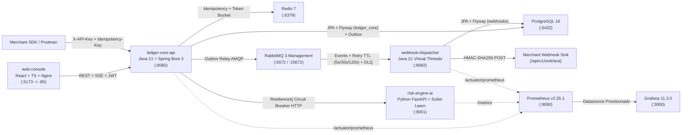

# 💳 LedgerPulse Platform (`v1.0.0`)

[-2ea44f?logo=githubactions&logoColor=white)](.github/workflows/ci.yml)
[](services/ledger-core-api/pom.xml)
[](services/risk-engine-ai/requirements.txt)
[](apps/web-console/package.json)
[](docker-compose.yml)

> **Plataforma Fintech B2B Distribuída & Full-Stack** — Double-Entry Ledger imutável, Split de Marketplace em centavos inteiros, Antifraude híbrido com IA (Java + Python/Scikit-Learn + Resilience4j), Transactional Outbox, Webhooks HMAC-SHA256 com Virtual Threads & DLQ no RabbitMQ, Dashboard Real-Time via SSE e Observabilidade provisionada com Prometheus + Grafana.

---

## 🎯 Diferenciais de Engenharia

- **Double-Entry Ledger Imutável (Partidas Dobradas):** Todo pagamento e estorno (`REFUND` / `PARTIALLY_REFUNDED`) gera lançamentos compensatórios append-only garantindo $\sum \text{Débitos} = \sum \text{Créditos}$, sem `UPDATE` ou `DELETE` em `ledger_entries`.
- **Zero Ponto Flutuante Monetário:** Todos os valores monetários trafegam e persistem estritamente em centavos inteiros (`BIGINT` no PostgreSQL, `long` em Java, `int` em Python, `number` inteiro em TypeScript).
- **Concorrência & Idempotência Distribuída:** Saldos protegidos por `@Version` (*Optimistic Locking* retornando `HTTP 409` em corrida) e `Idempotency-Key` com lock distribuído no Redis + hash SHA-256 canônico (`X-Idempotent-Replay: true`).
- **Antifraude Poliglota com Resiliência (`Resilience4j`):** `ledger-core-api` (Java 21) consulta `risk-engine-ai` (Python FastAPI + `IsolationForest` + `RandomForestClassifier` + regras determinísticas) protegido por Timeout, Retry e Circuit Breaker com fallback seguro para `MANUAL_REVIEW` (`RISK_ENGINE_UNAVAILABLE`).
- **Transactional Outbox + Webhooks HMAC-SHA256 + DLQ:** Eventos persistidos na mesma transação SQL do Ledger antes de serem publicados no RabbitMQ (`ledger.events`). O `webhook-dispatcher` (Java 21 Virtual Threads) assina payloads (`X-LedgerPulse-Signature: t=...,v1=...`), executa retries com TTL exponencial (`5s → 30s → 120s`) e isola falhas em `ledger.webhooks.dlq` com replay manual em 1 clique.
- **Tempo Real & Observabilidade Zero-Click:** Stream SSE via `fetch()` + `ReadableStream` autenticado com JWT, conciliação contábil `@Scheduled` + CSV, Rate Limiting Token Bucket em Redis (`HTTP 429`) e dashboards Grafana pré-provisionados consumindo Prometheus.

---

## 🏗️ Arquitetura dos 9 Containers



---

## 📦 Matriz de Módulos, Containers & Portas

| Serviço / Container | Caminho / Imagem | Stack Principal | Porta Host → Container | Health / Acesso |
| :--- | :--- | :--- | :---: | :--- |
| **`ledger-core-api`** | `services/ledger-core-api` | Java 21, Spring Boot 3.3+, Security JWT/API Key, JPA/Flyway, Resilience4j, Micrometer | `8080` → `8080` | `http://localhost:8080/api/v1/health` |
| **`risk-engine-ai`** | `services/risk-engine-ai` | Python 3.12 (`3.13` local), FastAPI, Pydantic v2, Scikit-Learn, Ruff, Pytest | `8001` → `8001` | `http://localhost:8001/health` |
| **`webhook-dispatcher`** | `services/webhook-dispatcher` | Java 21 (Virtual Threads), Spring AMQP, HMAC-SHA256, Flyway, Micrometer | `8082` → `8082` | `http://localhost:8082/api/v1/health` |
| **`web-console`** | `apps/web-console` | React 18, TypeScript strict, Vite, Tailwind CSS, Recharts, Vitest + RTL | `5173` → `80` | `http://localhost:5173` |
| **`postgres`** | `postgres:16-alpine` | PostgreSQL 16 (database `ledgerpulse`, schemas `ledger_core` & `webhooks`) | `5432` → `5432` | `pg_isready` (`infra/postgres/init/`) |
| **`redis`** | `redis:7-alpine` | Redis 7 (AOF ativo — Idempotência & Rate Limit Token Bucket) | `6379` → `6379` | `redis-cli ping` |
| **`rabbitmq`** | `rabbitmq:3-management-alpine` | RabbitMQ 3 + Management UI (`ledger.events`, `ledger.retry.*`, `ledger.webhooks.dlq`) | `5672` / `15672` | `http://localhost:15672` |
| **`prometheus`** | `prom/prometheus:v2.55.1` | Scrape de métricas a cada `10s` (`infra/prometheus/prometheus.yml`) | `9090` → `9090` | `http://localhost:9090/targets` |
| **`grafana`** | `grafana/grafana:11.3.0` | Dashboards & datasource Prometheus provisionados automaticamente | `3000` → `3000` | `http://localhost:3000` |

---

## 🚀 Quickstart (1 Comando)

> **Pré-requisito:** Docker Desktop / Docker Engine com Docker Compose v2 ativo.  
> Caso a porta `5432` já esteja ocupada por um PostgreSQL local no Windows, copie `.env.example` para `.env` e defina `POSTGRES_PORT=5433` (a comunicação interna entre containers permanece na `5432`).

```bash
# 1. (Opcional) Copiar template de variáveis locais
cp .env.example .env

# 2. Subir todos os 9 containers com build e healthchecks
docker compose up -d --build

# 3. Acompanhar status até todos ficarem healthy
docker compose ps
```

Atalhos disponíveis no [Makefile](Makefile) (`make help`):

```bash
make validate    # Valida sintaxe e interpolação do docker-compose.yml
make up          # Sobe a stack em background
make clean-boot  # Executa down -v e sobe do zero com --build
make health      # Tabela compacta com status de saúde dos containers
make e2e         # Executa fluxo E2E completo (Pagamento -> Ledger -> DLQ -> Replay)
make chaos       # Executa suite Load & Chaos (50 threads idempotentes, failover, DLQ, métricas)
make audit       # Executa validações offline (Compose, self-tests E2E/Chaos e JSON Grafana)
```

### 🌐 URLs Locais & Credenciais Dev

| Interface / Serviço | URL | Credenciais Padrão (`dev`/`local`) |
| :--- | :--- | :--- |
| **Web Console (UI)** | `http://localhost:5173` | Admin: `admin@ledgerpulse.dev` / `LedgerPulse@2026` · Analista: `analyst@ledgerpulse.dev` · Viewer: `viewer@ledgerpulse.dev` |
| **Grafana Dashboards** | `http://localhost:3000` | `admin` / `ledgerpulse_grafana` (configurável via `.env`) |
| **Prometheus Targets & UI** | `http://localhost:9090` | — |
| **RabbitMQ Management** | `http://localhost:15672` | `ledgerpulse` / `ledgerpulse_dev` |
| **Merchant API Key (Demo)** | Header `X-API-Key` | `lp_test_merchant_key_v1` (Merchant `7b92c3e0-1f42-4876-a1e2-901283471234`) |

---

## 🧪 Suítes de Teste, E2E & Chaos Engineering

Todas as suítes rodam automaticamente no pipeline [LedgerPulse CI](.github/workflows/ci.yml) e podem ser executadas localmente:

| Camada / Escopo | Comando de Execução | O que Valida |
| :--- | :--- | :--- |
| **`ledger-core-api` (Java 21)** | `cd services/ledger-core-api && mvn -B verify` | Invariantes de partidas dobradas, concorrência multi-thread `@Version` (`409`), idempotência Redis, Split, Outbox, Estornos, Conciliação, SSE, Rate Limit (`429`), Resilience4j MockWebServer e **Testcontainers** (`PostgreSQL 16` + `Redis 7`). |
| **`risk-engine-ai` (Python)** | `cd services/risk-engine-ai && ruff check . && pytest -v` | Lint Ruff, treino e serialização `.joblib` (`IsolationForest` + `RandomForestClassifier`), regras determinísticas, endpoints FastAPI e validação de contrato cruzado com DTOs Java. |
| **`webhook-dispatcher` (Java 21)** | `cd services/webhook-dispatcher && mvn -B test` | Topologia RabbitMQ Retry/DLQ, assinatura `HMAC-SHA256`, disparos em Virtual Threads, Webhook Sink (`OK_200`/`FAIL_500`/`TIMEOUT`) e Replay DLQ. |
| **`web-console` (React + TS)** | `cd apps/web-console && npx tsc --noEmit && npm test && npm run build` | Typecheck estrito, suíte **Vitest + React Testing Library** (formatação em centavos, Checkout Simulator, Fraud Modal, DLQ Console, Dashboard SSE, Conciliação) e bundle Vite. |
| **Fluxo E2E Completo** | `python3 infra/scripts/e2e_payment_dlq_flow.py` | Checkout com Split + replay `X-Idempotent-Replay: true` → Ledger balanceado → Sink `FAIL_500` → `DLQ` → Sink `OK_200` → Replay `DELIVERED` (`--self-test` offline incluso). |
| **Suite Load & Chaos** | `python3 infra/scripts/chaos_load_test.py` | (1) Burst de **50 requisições concorrentes** com mesma `Idempotency-Key` (= 1 única transação contábil), (2) derrubada de `risk-engine-ai` provando fallback `MANUAL_REVIEW` + Circuit Breaker, (3) falha/DLQ/replay de webhook e (4) scrape Prometheus nos 3 serviços — gera relatório em `infra/reports/chaos-load-report.md` (`--self-test` offline incluso). |

---

## 🏛️ Decisões Arquiteturais (ADRs) & Documentação Técnica

| Documento / ADR | Descrição | Link |
| :--- | :--- | :--- |
| **ADR-001** | Monorepo Poliglota (Java 21 + Python FastAPI + React/TS) e RabbitMQ | [ADR-001](docs/architecture/adr/ADR-001-monorepo-poliglota-e-rabbitmq.md) |
| **ADR-002** | Double-Entry Ledger Imutável, Precisão em Centavos (`BIGINT`) e Transactional Outbox | [ADR-002](docs/architecture/adr/ADR-002-double-entry-ledger-e-outbox.md) |
| **00 · Visão Arquitetural** | Componentes, sequência completa, máquina de estados `PaymentStatus` e pilares de resiliência | [00-visao-arquitetural.md](docs/architecture/00-visao-arquitetural.md) |
| **01 · Modelo de Dados Core** | Modelagem SQL & Migrations Flyway `V1`–`V6` (`ledger_core`) | [01-modelo-dados-v1.md](docs/architecture/01-modelo-dados-v1.md) |
| **02 · Modelo de Dados Webhooks** | Modelagem SQL & Migration `V1` (`webhooks`: endpoints, deliveries e attempts) | [02-modelo-dados-webhooks-v1.md](docs/architecture/02-modelo-dados-webhooks-v1.md) |
| **03 · Métricas & Troubleshooting** | Catálogo oficial de métricas Prometheus `v1.0.0`, queries PromQL e runbooks operacionais | [03-troubleshooting-e-operacao.md](docs/architecture/03-troubleshooting-e-operacao.md) |

---

## 🔌 Contratos API, Mensageria & Coleção Postman

- **Visão Geral & Payloads v1:** [docs/contracts/api-v1-overview.md](docs/contracts/api-v1-overview.md)
- **OpenAPI 3.1 (`ledger-core-api`):** [docs/contracts/openapi-ledger-core-v1.yaml](docs/contracts/openapi-ledger-core-v1.yaml)
- **OpenAPI 3.1 (`risk-engine-ai`):** [docs/contracts/openapi-risk-engine-v1.yaml](docs/contracts/openapi-risk-engine-v1.yaml)
- **OpenAPI 3.1 (`webhook-dispatcher`):** [docs/contracts/openapi-webhook-dispatcher-v1.yaml](docs/contracts/openapi-webhook-dispatcher-v1.yaml)
- **Topologia & Envelope RabbitMQ:** [docs/contracts/events-rabbitmq.md](docs/contracts/events-rabbitmq.md)
- **Coleção Postman v2.1 (pronta para importação):** [docs/contracts/ledgerpulse.postman_collection.json](docs/contracts/ledgerpulse.postman_collection.json)

---

## 📸 Screenshots & Evidências Visuais (Console Web & Grafana)

> *Espaços reservados para captura após subida local dos 9 containers (`docker compose up -d --build`) em `docs/assets/` (sem alterar código de aplicação):*

| Visão | Endpoint / Tela | Placeholder de Evidência |
| :--- | :--- | :--- |
| **Dashboard Executivo Real-Time (SSE)** | `http://localhost:5173/` | `<!--  -->` *(Capturar KPIs, gráficos Recharts e feed SSE ao vivo)* |
| **Auditoria Double-Entry Ledger** | `http://localhost:5173/ledger` | `<!--  -->` *(Capturar drawer exibindo lançamentos DEBIT/CREDIT balanceados)* |
| **Central Antifraude & Revisão Manual** | `http://localhost:5173/fraud-review` | `<!--  -->` *(Capturar medidor de risco ML e chips de reasonCodes)* |
| **Console Webhooks & Replay DLQ** | `http://localhost:5173/webhooks` | `<!--  -->` *(Capturar histórico HMAC-SHA256, modo Sink e replay DLQ)* |
| **Grafana — LedgerPulse Overview** | `http://localhost:3000/d/ledgerpulse-overview` | `<!--  -->` *(Capturar painéis de throughput, latência p95, Circuit Breaker e DLQ)* |

---

## 🤝 Governança, Workflow Git & Release

- **Governança Multi-Chat:** [AGENTS.md](AGENTS.md)
- **Roadmap de 42 Dias:** [docs/ROADMAP-6-SEMANAS.md](docs/ROADMAP-6-SEMANAS.md)
- **Padrão Git (Issues, Branches, Micro-Commits, PRs):** [docs/workflow/git-commits-prs-padrao.md](docs/workflow/git-commits-prs-padrao.md)
- **Checklist Final `v1.0.0` & Posts LinkedIn:** [docs/workflow/release-v1.0.0-checklist-and-linkedin.md](docs/workflow/release-v1.0.0-checklist-and-linkedin.md)
