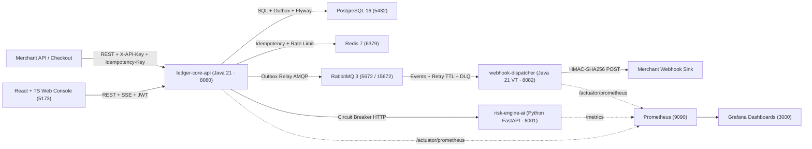

# 💳 LedgerPulse Platform — Plataforma Fintech Distribuída & Full-Stack

> **Status Atual:** `Fase 0 — Governança, Arquitetura Base & Contratos Definidos` (veja [docs/STATUS.md](file:///C:/Users/aliss/OneDrive/Documentos/AlissonDev/Estudo_Java/ProjetosGitHub/ledgerpulse-platform/docs/STATUS.md))  
> **Escopo:** Projeto Flagship de Engenharia de Software (6 Semanas / 42 Dias Úteis)  
> **Stack:** Java 21 · Spring Boot 3 · Python 3.13/3.12 · FastAPI · Scikit-Learn · PostgreSQL 16 · Redis 7 · RabbitMQ 3 · React + TypeScript + Tailwind · Prometheus & Grafana

---

## 🎯 O que é o LedgerPulse?

O **LedgerPulse** é uma plataforma Fintech B2B inspirada em motores modernos de pagamento, conciliação contábil e infraestrutura de webhooks. Em vez de um CRUD tradicional, o sistema resolve problemas reais de **sistemas distribuídos críticos**:

- **Double-Entry Ledger Imutável (Partidas Dobradas):** Toda movimentação gera lançamentos balanceados ($\sum \text{Débitos} = \sum \text{Créditos}$) em centavos inteiros (`BIGINT` / `amountCents`), sem `UPDATE` ou `DELETE`.
- **Motor de Split & Concorrência Otimista (`@Version`):** Divisão automática entre *merchant*, recebedores e taxa da plataforma, com proteção contra condição de corrida em saldos.
- **Idempotência Distribuída (`Idempotency-Key` + Redis):** Garantia de que retentativas de rede nunca cobram o mesmo pedido duas vezes.
- **Antifraude Híbrido com IA (`risk-engine-ai` em Python/FastAPI):** Score em tempo real combinando modelo Scikit-Learn (`IsolationForest` / `RandomForest`) + regras determinísticas com `reason_codes` explicáveis, protegido no Java via **Resilience4j (Circuit Breaker + Timeout + Fallback)** para o fluxo `MANUAL_REVIEW`.
- **Transactional Outbox + Webhooks Resilientes:** Publicação garantida no **RabbitMQ**, entrega assinada com **HMAC-SHA256** (`X-LedgerPulse-Signature`) usando **Java 21 Virtual Threads**, retentativas com **Backoff Exponencial (5s → 30s → 120s)** e **Dead-Letter Queue (DLQ)** com replay manual.
- **Console Web Real-Time (`web-console`):** Dashboard executivo em **React + TypeScript** com feed ao vivo via **Server-Sent Events (SSE)**, auditoria de partidas dobradas, central de revisão antifraude, simulador de checkout e console de reprocessamento de DLQ.

---

## 🏗️ Arquitetura de Alto Nível

---

## 📦 Módulos do Monorepo

| Módulo | Caminho | Tecnologia Principal | Porta Local | Responsabilidade |
| :--- | :--- | :--- | :---: | :--- |
| **Core Financeiro & Ledger** | `services/ledger-core-api` | Java 21, Spring Boot 3.3+, Security JWT, JPA/Flyway, Resilience4j | `8080` | Contas, Ledger Partidas Dobradas, Pagamentos, Split, Estornos, Outbox, Conciliação e SSE. |
| **Motor Antifraude IA** | `services/risk-engine-ai` | Python 3.13/3.12, FastAPI, Pydantic v2, Scikit-Learn, Pytest | `8001` | Avaliação de risco em tempo real, modelo ML treinado, regras híbridas e `reason_codes`. |
| **Disparador de Webhooks** | `services/webhook-dispatcher` | Java 21 (Virtual Threads), Spring AMQP, HMAC-SHA256 | `8082` | Consumo RabbitMQ, assinatura HMAC, retries exponenciais, DLQ, replay e Webhook Sink. |
| **Console Web Real-Time** | `apps/web-console` | React, TypeScript, Vite, Tailwind CSS, Recharts, Vitest | `5173` | Dashboard SSE, Auditoria do Ledger, Revisão Antifraude, Console DLQ e Simulador Checkout. |
| **Infra & Observabilidade** | `infra/` + `docker-compose.yml` | Docker Compose, PostgreSQL 16, Redis 7, RabbitMQ 3, Prometheus, Grafana | `5432` / `6379` / `5672` / `9090` / `3000` | Orquestração local completa, provisionamento de dashboards e scripts de Chaos/Load Test. |

---

## 🗓️ Cronograma de 6 Semanas (42 Dias Úteis)

O desenvolvimento segue o método de **micro-entregas diárias atômicas (20–35 min/dia)** detalhado em [docs/ROADMAP-6-SEMANAS.md](file:///C:/Users/aliss/OneDrive/Documentos/AlissonDev/Estudo_Java/ProjetosGitHub/ledgerpulse-platform/docs/ROADMAP-6-SEMANAS.md):

1. **Semana 1 (Dias 01–07):** Infraestrutura Docker, Contratos OpenAPI/Eventos, Bootstrap `ledger-core-api` (Flyway + Security) e Bootstrap `web-console`.
2. **Semana 2 (Dias 08–14):** Double-Entry Ledger imutável, `@Version` Optimistic Locking, Idempotência Redis, Split de Pagamentos, Transactional Outbox e UI de Ledger/Contas.
3. **Semana 3 (Dias 15–21):** Microsserviço Python `risk-engine-ai` (Scikit-Learn + FastAPI), Resilience4j Circuit Breaker no Java, Fluxo `MANUAL_REVIEW` e Central Antifraude no Frontend.
4. **Semana 4 (Dias 22–28):** Microsserviço `webhook-dispatcher`, Topologia RabbitMQ com Retry TTL + DLQ, Assinatura HMAC-SHA256, Webhook Sink, Console DLQ + Simulador Checkout + E2E.
5. **Semana 5 (Dias 29–35):** Stream Tempo Real SSE, Estornos compensatórios (`REFUND`), Conciliação Financeira `@Scheduled` + CSV, Dashboard Real-Time e Rate Limiting Token Bucket.
6. **Semana 6 (Dias 36–42):** Métricas Prometheus, Dashboards Grafana, Load & Chaos Testing, Documentação C4/Postman, Auditoria Final e Release `v1.0.0`.

---

## 📚 Documentação Essencial

- **Governança Multi-Chat:** [AGENTS.md](file:///C:/Users/aliss/OneDrive/Documentos/AlissonDev/Estudo_Java/ProjetosGitHub/ledgerpulse-platform/AGENTS.md)
- **Ativação dos 5 Chats:** [docs/BOOTSTRAP_CHATS.md](file:///C:/Users/aliss/OneDrive/Documentos/AlissonDev/Estudo_Java/ProjetosGitHub/ledgerpulse-platform/docs/BOOTSTRAP_CHATS.md)
- **Estado Compartilhado:** [docs/STATUS.md](file:///C:/Users/aliss/OneDrive/Documentos/AlissonDev/Estudo_Java/ProjetosGitHub/ledgerpulse-platform/docs/STATUS.md)
- **Visão Arquitetural & Diagramas:** [docs/architecture/00-visao-arquitetural.md](file:///C:/Users/aliss/OneDrive/Documentos/AlissonDev/Estudo_Java/ProjetosGitHub/ledgerpulse-platform/docs/architecture/00-visao-arquitetural.md)
- **Contratos API & Eventos:** [docs/contracts/README.md](file:///C:/Users/aliss/OneDrive/Documentos/AlissonDev/Estudo_Java/ProjetosGitHub/ledgerpulse-platform/docs/contracts/README.md)
- **Padrão Git, Issues, PRs & LinkedIn:** [docs/workflow/git-commits-prs-padrao.md](file:///C:/Users/aliss/OneDrive/Documentos/AlissonDev/Estudo_Java/ProjetosGitHub/ledgerpulse-platform/docs/workflow/git-commits-prs-padrao.md)
