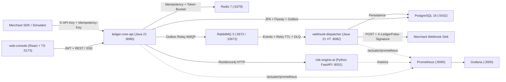
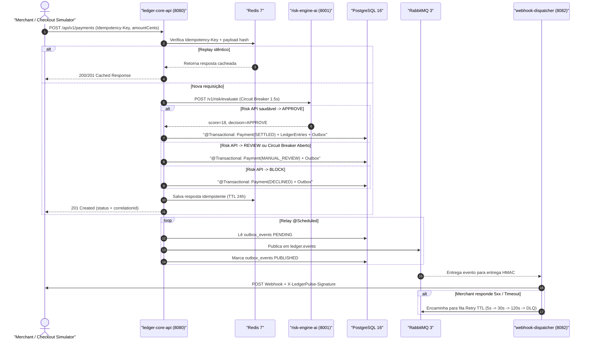
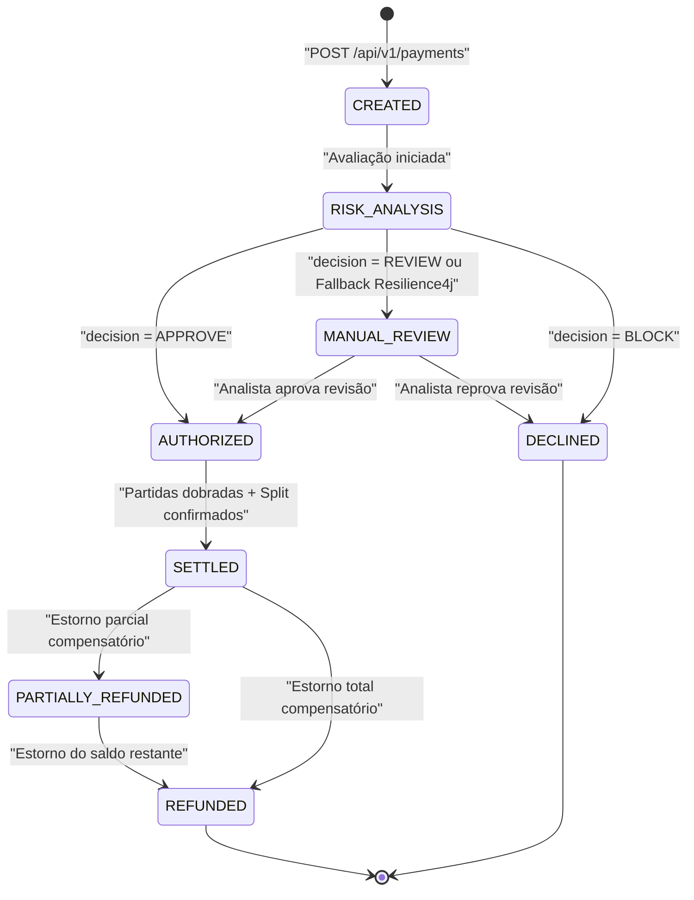

# 🏛️ 00 — Visão Arquitetural da Plataforma (`LedgerPulse`)

> **Responsável:** Chat 01 (Arquiteto de Software & Contratos)  
> **Domínio:** Fintech B2B (Pagamentos, Split de Marketplace, Double-Entry Ledger, Antifraude IA e Webhooks Resilientes)  
> **Padrão de Design:** Clean Room Design (100% original, zero dependência de projetos anteriores)

---

## 1. 🧩 Módulos Executáveis e Infraestrutura

A plataforma é organizada como um **monorepo poliglota** composto por **4 módulos executáveis** e **5 componentes de infraestrutura/observabilidade**:

| Componente | Caminho | Stack | Responsabilidade Central |
| :--- | :--- | :--- | :--- |
| **`ledger-core-api`** | `services/ledger-core-api` | Java 21, Spring Boot 3.3+, Security 6, JPA, Flyway, Resilience4j | Núcleo transacional: Contas, Double-Entry Ledger, Pagamentos, Split, Estornos, Outbox, Conciliação e SSE. |
| **`risk-engine-ai`** | `services/risk-engine-ai` | Python 3.13/3.12, FastAPI, Pydantic v2, Scikit-Learn | Microsserviço de Antifraude Híbrido (ML + Regras determinísticas) com `reasonCodes` explicáveis. |
| **`webhook-dispatcher`** | `services/webhook-dispatcher` | Java 21 (Virtual Threads), Spring Boot 3.3+, Spring AMQP | Consumo de eventos RabbitMQ, assinatura HMAC-SHA256, retries exponenciais, DLQ e replay manual. |
| **`web-console`** | `apps/web-console` | React, TypeScript, Vite, Tailwind CSS, Recharts | Console administrativo real-time (SSE), auditoria contábil, revisão antifraude, DLQ e simulador de checkout. |
| **PostgreSQL 16** | Container `postgres` | PostgreSQL 16 (`ledger_core` e `webhooks`) | Fonte da verdade relacional e transacional (Ledger append-only + Outbox). |
| **Redis 7** | Container `redis` | Redis 7 | Lock/cache de `Idempotency-Key` e Rate Limiting (Token Bucket). |
| **RabbitMQ 3** | Container `rabbitmq` | RabbitMQ 3 + Management UI | Backbone assíncrono de eventos (`ledger.events`), filas de retry com TTL e DLQ. |
| **Prometheus + Grafana** | `infra/prometheus`, `infra/grafana` | Prometheus + Grafana | Coleta de métricas técnicas/negócio e dashboards provisionados automaticamente. |

---

## 2. 🗺️ Diagrama de Componentes

---

## 3. 🔄 Fluxo Principal de Pagamento, Risco, Ledger e Webhook

---

## 4. ⚙️ Máquina de Estados do Pagamento (`PaymentStatus`)

---

## 5. 🔌 Matriz de Portas Locais Padronizadas

| Serviço / Recurso | Host Port | Container Port | URL Local / Health |
| :--- | :---: | :---: | :--- |
| **`ledger-core-api`** | `8080` | `8080` | `http://localhost:8080/actuator/health` |
| **`risk-engine-ai`** | `8001` | `8001` | `http://localhost:8001/health` |
| **`webhook-dispatcher`** | `8082` | `8082` | `http://localhost:8082/actuator/health` |
| **`web-console`** | `5173` | `5173` | `http://localhost:5173` |
| **PostgreSQL 16** | `5432` | `5432` | `localhost:5432` |
| **Redis 7** | `6379` | `6379` | `localhost:6379` |
| **RabbitMQ (AMQP / UI)** | `5672` / `15672` | `5672` / `15672` | `http://localhost:15672` |
| **Prometheus** | `9090` | `9090` | `http://localhost:9090` |
| **Grafana** | `3000` | `3000` | `http://localhost:3000` |

---

## 6. 🛡️ Pilares de Segurança & Resiliência

### Segurança
1. **Dois canais claros de autenticação no `ledger-core-api`:**
   - **Operadores Internos (Web Console):** `Authorization: Bearer <JWT>` com papéis (`ADMIN`, `ANALYST`, `VIEWER`).
   - **Merchants / Integrações Server-to-Server:** Header `X-API-Key` vinculado ao `merchantId`, protegido com Rate Limiting em Redis.
2. **Integridade de Webhooks:** Todo webhook disparado inclui timestamp e assinatura **HMAC-SHA256** no header `X-LedgerPulse-Signature: t=<epoch>,v1=<hex_hmac>`.
3. **Auditabilidade:** Todas as requisições carregam ou geram `X-Correlation-Id` propagado nos logs estruturados, banco de dados, eventos RabbitMQ e SSE.

### Resiliência
1. **Concorrência no Ledger (`@Version`):** Impede *lost updates* em saldos de contas sob requisições simultâneas, retornando `HTTP 409 Conflict` quando aplicável.
2. **Idempotência Distribuída:** `Idempotency-Key` no Redis evita cobranças duplicadas em falhas de rede.
3. **Transactional Outbox:** Elimina o problema de *dual write* entre PostgreSQL e RabbitMQ.
4. **Circuit Breaker Java → Python:** Se o `risk-engine-ai` degradar ou cair, o pagamento **não é perdido** nem aprovado às cegas — entra em `MANUAL_REVIEW` via fallback.
5. **Backoff Exponencial + DLQ:** Falhas de entrega de webhook seguem retries `5s → 30s → 120s` via TTL no RabbitMQ antes de estacionar em `ledger.webhooks.dlq` para replay manual.
