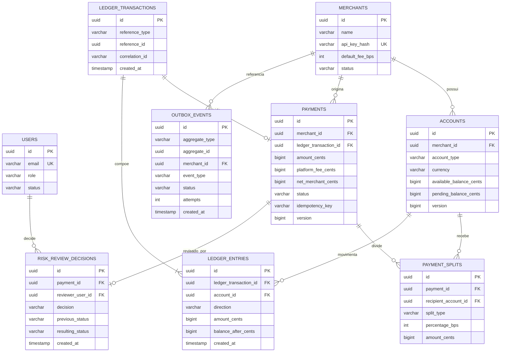

# 🗄️ 01 — Modelagem Conceitual de Dados v1 (`ledger_core`)

> **Versão:** `v1.2-frozen` (Semanas 1, 2 e 3 · Inclui Outbox V3 e Risk Review Decisions V4)  
> **Responsável:** Chat 01 (Arquiteto de Software & Contratos)  
> **Banco Alvo:** PostgreSQL 16 · Database `ledgerpulse` · Schema `ledger_core` (conforme decisão fechada em [STATUS.md](file:///C:/Users/aliss/OneDrive/Documentos/AlissonDev/Estudo_Java/ProjetosGitHub/ledgerpulse-platform/docs/STATUS.md) e [01-create-schemas.sql](file:///C:/Users/aliss/OneDrive/Documentos/AlissonDev/Estudo_Java/ProjetosGitHub/ledgerpulse-platform/infra/postgres/init/01-create-schemas.sql))

---

## 1. Visão Geral & Diagrama Entidade-Relacionamento

O schema `ledger_core` isola todas as entidades transacionais do `ledger-core-api` (enquanto o schema `webhooks` fica reservado para o `webhook-dispatcher` na Semana 4).

---

## 2. Migration `V1__create_merchants_and_accounts.sql` (Dia 04)

### 2.1 `ledger_core.users`
Operadores internos autenticados via JWT no `web-console`.

| Coluna | Tipo SQL | Restrições / Default | Descrição |
| :--- | :--- | :--- | :--- |
| `id` | `UUID` | `PRIMARY KEY` | Identificador único gerado na aplicação (`UUID`). |
| `name` | `VARCHAR(120)` | `NOT NULL` | Nome de exibição do operador. |
| `email` | `VARCHAR(160)` | `NOT NULL UNIQUE` | Login único (case-insensitive / normalizado em lowercase). |
| `password_hash` | `VARCHAR(255)` | `NOT NULL` | Hash BCrypt da senha (nunca texto puro). |
| `role` | `VARCHAR(20)` | `NOT NULL CHECK (role IN ('ADMIN', 'ANALYST', 'VIEWER'))` | Papel RBAC do operador. |
| `status` | `VARCHAR(20)` | `NOT NULL DEFAULT 'ACTIVE' CHECK (status IN ('ACTIVE', 'INACTIVE'))` | Estado da conta do operador. |
| `created_at` | `TIMESTAMP WITH TIME ZONE` | `NOT NULL DEFAULT CURRENT_TIMESTAMP` | Data/hora UTC de criação. |
| `updated_at` | `TIMESTAMP WITH TIME ZONE` | `NOT NULL DEFAULT CURRENT_TIMESTAMP` | Data/hora UTC da última atualização. |

**Índices:** `UNIQUE (email)` já cria índice único implícito para autenticação.

---

### 2.2 `ledger_core.merchants`
Estabelecimentos integradores autenticados via `X-API-Key`.

| Coluna | Tipo SQL | Restrições / Default | Descrição |
| :--- | :--- | :--- | :--- |
| `id` | `UUID` | `PRIMARY KEY` | Identificador único do merchant. |
| `name` | `VARCHAR(160)` | `NOT NULL` | Nome comercial do merchant. |
| `api_key_hash` | `VARCHAR(64)` | `NOT NULL UNIQUE` | Hash **SHA-256 hex** da `X-API-Key` (64 chars). |
| `default_fee_bps` | `INTEGER` | `NOT NULL DEFAULT 250 CHECK (default_fee_bps >= 0 AND default_fee_bps <= 10000)` | Taxa padrão da plataforma em basis points (`250` = `2.50%`). |
| `status` | `VARCHAR(20)` | `NOT NULL DEFAULT 'ACTIVE' CHECK (status IN ('ACTIVE', 'SUSPENDED'))` | Estado operacional do merchant. |
| `created_at` | `TIMESTAMP WITH TIME ZONE` | `NOT NULL DEFAULT CURRENT_TIMESTAMP` | Data/hora UTC de criação. |
| `updated_at` | `TIMESTAMP WITH TIME ZONE` | `NOT NULL DEFAULT CURRENT_TIMESTAMP` | Data/hora UTC da última atualização. |

**Índices:** `UNIQUE (api_key_hash)` acelera a resolução do filtro `X-API-Key`.

---

### 2.3 `ledger_core.accounts`
Contas contábeis/financeiras com controle de concorrência otimista (`@Version`).

| Coluna | Tipo SQL | Restrições / Default | Descrição |
| :--- | :--- | :--- | :--- |
| `id` | `UUID` | `PRIMARY KEY` | Identificador único da conta. |
| `merchant_id` | `UUID` | `NULL REFERENCES ledger_core.merchants(id)` | Vinculado para `MERCHANT`/`RECIPIENT`; `NULL` permitido para contas sistêmicas (`ESCROW`, `PLATFORM_FEE`). |
| `account_type` | `VARCHAR(30)` | `NOT NULL CHECK (account_type IN ('MERCHANT', 'PLATFORM_FEE', 'ESCROW', 'RECIPIENT'))` | Natureza contábil da conta. |
| `holder_name` | `VARCHAR(160)` | `NOT NULL` | Titular da conta. |
| `currency` | `VARCHAR(3)` | `NOT NULL DEFAULT 'BRL' CHECK (currency = 'BRL')` | Moeda ISO-4217. |
| `available_balance_cents` | `BIGINT` | `NOT NULL DEFAULT 0` | Saldo disponível em centavos inteiros. |
| `pending_balance_cents` | `BIGINT` | `NOT NULL DEFAULT 0 CHECK (pending_balance_cents >= 0)` | Saldo pendente/bloqueado em centavos inteiros. |
| `status` | `VARCHAR(20)` | `NOT NULL DEFAULT 'ACTIVE' CHECK (status IN ('ACTIVE', 'BLOCKED'))` | Estado da conta. |
| `version` | `BIGINT` | `NOT NULL DEFAULT 0` | Versão JPA (`@Version`) contra *lost updates*. |
| `created_at` | `TIMESTAMP WITH TIME ZONE` | `NOT NULL DEFAULT CURRENT_TIMESTAMP` | Data/hora UTC de criação. |
| `updated_at` | `TIMESTAMP WITH TIME ZONE` | `NOT NULL DEFAULT CURRENT_TIMESTAMP` | Data/hora UTC da última atualização. |

> **Regra Contábil de Saldo (Congelada para Semana 2):**
> - **`CREDIT`** **soma** `amountCents` em `available_balance_cents`; **`DEBIT`** **subtrai** `amountCents` de `available_balance_cents`.
> - A conta sistêmica **`ESCROW`** recebe `DEBIT` na liquidação (`PAYMENT_SETTLEMENT`) e **pode assumir saldo negativo** (representando recursos capturados do adquirente); por isso não há `CHECK (available_balance_cents >= 0)` genérico na tabela `accounts`.
> - A proteção contra saldo insuficiente em contas de recebedores ou estornos é validada na camada de domínio (`LedgerService`).

**Índices V1 (`accounts`):**
- `idx_accounts_merchant_id` ON `ledger_core.accounts (merchant_id)`
- `idx_accounts_type` ON `ledger_core.accounts (account_type)`

---

## 3. Migration `V2__create_ledger_and_payments.sql` (Dia 04)

> **Ordem de criação na V2:** criar `ledger_transactions` antes de `payments` e `ledger_entries` para permitir chave estrangeira direta de `payments.ledger_transaction_id -> ledger_transactions(id)`.

### 3.1 `ledger_core.ledger_transactions` (Imutável — Append-Only)
Cabeçalho de uma movimentação contábil de partidas dobradas.

| Coluna | Tipo SQL | Restrições / Default | Descrição |
| :--- | :--- | :--- | :--- |
| `id` | `UUID` | `PRIMARY KEY` | Identificador único da transação contábil. |
| `reference_type` | `VARCHAR(40)` | `NOT NULL CHECK (reference_type IN ('PAYMENT_SETTLEMENT', 'PAYMENT_REFUND', 'MANUAL_ADJUSTMENT'))` | Origem da movimentação. |
| `reference_id` | `UUID` | `NOT NULL` | ID da entidade de negócio associada (ex.: `payment.id`). |
| `description` | `VARCHAR(255)` | `NOT NULL` | Descrição auditável do lançamento. |
| `currency` | `VARCHAR(3)` | `NOT NULL DEFAULT 'BRL' CHECK (currency = 'BRL')` | Moeda ISO-4217. |
| `correlation_id` | `VARCHAR(64)` | `NOT NULL` | `X-Correlation-Id` propagado. |
| `created_at` | `TIMESTAMP WITH TIME ZONE` | `NOT NULL DEFAULT CURRENT_TIMESTAMP` | Data/hora UTC de criação (**sem `updated_at`**). |

---

### 3.2 `ledger_core.ledger_entries` (Estritamente Append-Only — Sem `UPDATE`/`DELETE`)
Linhas individuais de débito e crédito. **Invariantes obrigatórios:**
1. Todo lançamento exige **`amountCents > 0`** (nunca zero ou negativo).
2. Toda `ledger_transaction` exige **no mínimo 2 pernas** (`entries.size() >= 2`) e equilíbrio contábil estrito:
   $$\sum \text{amount\_cents (DEBIT)} = \sum \text{amount\_cents (CREDIT)}$$
3. Lançamentos contábeis seguem estritamente a regra `CREDIT` soma e `DEBIT` subtrai `amountCents` do saldo da conta correspondente (`balance_after_cents` registra o snapshot resultante após a movimentação).

| Coluna | Tipo SQL | Restrições / Default | Descrição |
| :--- | :--- | :--- | :--- |
| `id` | `UUID` | `PRIMARY KEY` | Identificador único do lançamento. |
| `ledger_transaction_id` | `UUID` | `NOT NULL REFERENCES ledger_core.ledger_transactions(id)` | Transação contábil pai. |
| `account_id` | `UUID` | `NOT NULL REFERENCES ledger_core.accounts(id)` | Conta movimentada. |
| `direction` | `VARCHAR(10)` | `NOT NULL CHECK (direction IN ('DEBIT', 'CREDIT'))` | Direção do lançamento contábil. |
| `amount_cents` | `BIGINT` | `NOT NULL CHECK (amount_cents > 0)` | Valor estritamente positivo em centavos inteiros. |
| `balance_after_cents` | `BIGINT` | `NOT NULL` | Snapshot do saldo da conta imediatamente após este lançamento. |
| `created_at` | `TIMESTAMP WITH TIME ZONE` | `NOT NULL DEFAULT CURRENT_TIMESTAMP` | Data/hora UTC de criação (**sem `updated_at`**). |

---

### 3.3 `ledger_core.payments`
Registro do ciclo de vida do pagamento e vínculo idempotente.

| Coluna | Tipo SQL | Restrições / Default | Descrição |
| :--- | :--- | :--- | :--- |
| `id` | `UUID` | `PRIMARY KEY` | Identificador único do pagamento. |
| `merchant_id` | `UUID` | `NOT NULL REFERENCES ledger_core.merchants(id)` | Merchant proprietário da cobrança. |
| `payer_id` | `VARCHAR(120)` | `NOT NULL` | Identificador do pagador no merchant. |
| `amount_cents` | `BIGINT` | `NOT NULL CHECK (amount_cents > 0)` | Valor bruto em centavos inteiros (`> 0`). |
| `platform_fee_cents` | `BIGINT` | `NOT NULL DEFAULT 0 CHECK (platform_fee_cents >= 0)` | Taxa calculada da plataforma em centavos. |
| `net_merchant_cents` | `BIGINT` | `NOT NULL DEFAULT 0 CHECK (net_merchant_cents >= 0)` | Valor líquido destinado ao merchant após taxa e splits. |
| `currency` | `VARCHAR(3)` | `NOT NULL DEFAULT 'BRL' CHECK (currency = 'BRL')` | Moeda ISO-4217. |
| `payment_method` | `VARCHAR(30)` | `NOT NULL CHECK (payment_method IN ('CARD', 'PIX', 'BOLETO'))` | Meio de pagamento. |
| `description` | `VARCHAR(255)` | `NULL` | Descrição opcional do pedido. |
| `status` | `VARCHAR(30)` | `NOT NULL CHECK (status IN ('CREATED', 'RISK_ANALYSIS', 'AUTHORIZED', 'MANUAL_REVIEW', 'SETTLED', 'DECLINED', 'PARTIALLY_REFUNDED', 'REFUNDED'))` | Estado atual da máquina de estados. |
| `risk_score` | `INTEGER` | `NULL CHECK (risk_score IS NULL OR (risk_score >= 0 AND risk_score <= 100))` | Score retornado pelo `risk-engine-ai` (`0..100`). |
| `risk_decision` | `VARCHAR(20)` | `NULL CHECK (risk_decision IS NULL OR risk_decision IN ('APPROVE', 'REVIEW', 'BLOCK'))` | Decisão antifraude. |
| `reason_codes_json` | `TEXT` | `NOT NULL DEFAULT '[]'` | Lista JSON serializada de `reasonCodes`. |
| `idempotency_key` | `VARCHAR(128)` | `NOT NULL` | Chave enviada no header `Idempotency-Key`. |
| `correlation_id` | `VARCHAR(64)` | `NOT NULL` | `X-Correlation-Id` da requisição. |
| `ledger_transaction_id` | `UUID` | `NULL REFERENCES ledger_core.ledger_transactions(id)` | Preenchida quando liquidado (`SETTLED`). |
| `version` | `BIGINT` | `NOT NULL DEFAULT 0` | Versão JPA (`@Version`). |
| `created_at` | `TIMESTAMP WITH TIME ZONE` | `NOT NULL DEFAULT CURRENT_TIMESTAMP` | Data/hora UTC de criação. |
| `updated_at` | `TIMESTAMP WITH TIME ZONE` | `NOT NULL DEFAULT CURRENT_TIMESTAMP` | Data/hora UTC da última atualização. |

**Constraint Única:** `CONSTRAINT uq_payments_merchant_idempotency UNIQUE (merchant_id, idempotency_key)`

---

### 3.4 `ledger_core.payment_splits`
Regras de repartição calculadas e persistidas para cada pagamento.

| Coluna | Tipo SQL | Restrições / Default | Descrição |
| :--- | :--- | :--- | :--- |
| `id` | `UUID` | `PRIMARY KEY` | Identificador único do item de split. |
| `payment_id` | `UUID` | `NOT NULL REFERENCES ledger_core.payments(id)` | Pagamento pai. |
| `recipient_account_id` | `UUID` | `NOT NULL REFERENCES ledger_core.accounts(id)` | Conta `RECIPIENT` beneficiada. |
| `split_type` | `VARCHAR(20)` | `NOT NULL CHECK (split_type IN ('PERCENTAGE', 'FIXED'))` | Tipo de regra de divisão. |
| `percentage_bps` | `INTEGER` | `NULL CHECK (percentage_bps IS NULL OR (percentage_bps > 0 AND percentage_bps <= 10000))` | Percentual em basis points quando `PERCENTAGE`. |
| `amount_cents` | `BIGINT` | `NOT NULL CHECK (amount_cents > 0)` | Valor efetivo calculado em centavos inteiros (`> 0`). |
| `created_at` | `TIMESTAMP WITH TIME ZONE` | `NOT NULL DEFAULT CURRENT_TIMESTAMP` | Data/hora UTC de criação. |

**Constraint Única:** `CONSTRAINT uq_payment_splits_payment_recipient UNIQUE (payment_id, recipient_account_id)`

**Índices V2:**
- `idx_payments_merchant_created` ON `ledger_core.payments (merchant_id, created_at DESC)`
- `idx_payments_status_created` ON `ledger_core.payments (status, created_at DESC)`
- `idx_payments_correlation` ON `ledger_core.payments (correlation_id)`
- `idx_payment_splits_payment` ON `ledger_core.payment_splits (payment_id)`
- `idx_ledger_tx_reference` ON `ledger_core.ledger_transactions (reference_type, reference_id)`
- `idx_ledger_tx_created` ON `ledger_core.ledger_transactions (created_at DESC)`
- `idx_ledger_entries_tx` ON `ledger_core.ledger_entries (ledger_transaction_id)`
- `idx_ledger_entries_account_created` ON `ledger_core.ledger_entries (account_id, created_at DESC)`

---

## 4. Migration `V3__create_outbox_events.sql` (Dia 12 — Transactional Outbox)

### 4.1 `ledger_core.outbox_events`
Tabela de eventos transacionais persistidos **na mesma `@Transactional`** que grava `payments` e `ledger_entries` (eliminando *dual-write*), lida pelo `OutboxRelayWorker` para publicação *at-least-once* na exchange `ledger.events` do RabbitMQ conforme [events-rabbitmq.md](file:///C:/Users/aliss/OneDrive/Documentos/AlissonDev/Estudo_Java/ProjetosGitHub/ledgerpulse-platform/docs/contracts/events-rabbitmq.md).

| Coluna | Tipo SQL | Restrições / Default | Descrição |
| :--- | :--- | :--- | :--- |
| `id` | `UUID` | `PRIMARY KEY` | Identificador único do registro Outbox (utilizado como `eventId` no envelope RabbitMQ). |
| `aggregate_type` | `VARCHAR(40)` | `NOT NULL` | Tipo do agregado de origem (ex.: `'PAYMENT'`). |
| `aggregate_id` | `UUID` | `NOT NULL` | Identificador do agregado (ex.: `payment.id`). |
| `merchant_id` | `UUID` | `NOT NULL REFERENCES ledger_core.merchants(id)` | Merchant proprietário do evento. |
| `event_type` | `VARCHAR(80)` | `NOT NULL` | Routing key oficial (`payment.created`, `payment.settled`, `payment.declined`, `payment.manual_review_required`, `payment.refunded`, `risk.feedback.recorded`). |
| `correlation_id` | `VARCHAR(64)` | `NOT NULL` | `X-Correlation-Id` propagado para o header AMQP. |
| `payload_json` | `TEXT` | `NOT NULL` | Envelope JSON completo conforme `docs/contracts/events-rabbitmq.md`. |
| `status` | `VARCHAR(20)` | `NOT NULL DEFAULT 'PENDING' CHECK (status IN ('PENDING', 'PUBLISHED', 'FAILED'))` | Estado de entrega ao broker RabbitMQ. |
| `attempts` | `INTEGER` | `NOT NULL DEFAULT 0 CHECK (attempts >= 0)` | Contador de tentativas de publicação pelo relay. |
| `last_error` | `TEXT` | `NULL` | Última mensagem de erro registrada em falha de envio. |
| `created_at` | `TIMESTAMP WITH TIME ZONE` | `NOT NULL DEFAULT CURRENT_TIMESTAMP` | Data/hora UTC de criação na transação SQL. |
| `published_at` | `TIMESTAMP WITH TIME ZONE` | `NULL` | Data/hora UTC da confirmação de publicação no RabbitMQ. |

**Índices V3 (`outbox_events`):**
- `idx_outbox_status_created` ON `ledger_core.outbox_events (status, created_at ASC)`
- `idx_outbox_aggregate` ON `ledger_core.outbox_events (aggregate_type, aggregate_id)`

---

## 5. Migration `V4__create_risk_review_decisions.sql` (Dia 19 — Revisão Manual Antifraude)

### 5.1 `ledger_core.risk_review_decisions`
Registro auditável da decisão humana (`APPROVE` / `DECLINE`) tomada por analista (`ANALYST` ou `ADMIN`) sobre pagamentos retidos em `MANUAL_REVIEW`.

| Coluna | Tipo SQL | Restrições / Default | Descrição |
| :--- | :--- | :--- | :--- |
| `id` | `UUID` | `PRIMARY KEY` | Identificador único da decisão de revisão. |
| `payment_id` | `UUID` | `NOT NULL UNIQUE REFERENCES ledger_core.payments(id)` | Pagamento revisado (no máximo uma decisão final por pagamento). |
| `reviewer_user_id` | `UUID` | `NOT NULL REFERENCES ledger_core.users(id)` | Operador (`ANALYST`/`ADMIN`) que decidiu. |
| `reviewer_email` | `VARCHAR(160)` | `NOT NULL` | Snapshot do email do revisor para auditoria direta. |
| `decision` | `VARCHAR(20)` | `NOT NULL CHECK (decision IN ('APPROVE', 'DECLINE'))` | Decisão registrada na revisão manual. |
| `justification` | `VARCHAR(500)` | `NOT NULL` | Justificativa obrigatória registrada pelo analista (`5..500` chars). |
| `previous_status` | `VARCHAR(30)` | `NOT NULL` | Estado anterior do pagamento (esperado `'MANUAL_REVIEW'`). |
| `resulting_status` | `VARCHAR(30)` | `NOT NULL CHECK (resulting_status IN ('SETTLED', 'DECLINED'))` | Estado resultante após liquidar ou recusar. |
| `correlation_id` | `VARCHAR(64)` | `NOT NULL` | `X-Correlation-Id` da requisição de revisão. |
| `created_at` | `TIMESTAMP WITH TIME ZONE` | `NOT NULL DEFAULT CURRENT_TIMESTAMP` | Data/hora UTC da decisão. |

**Índices V4 (`risk_review_decisions`):**
- `idx_risk_review_decisions_created` ON `ledger_core.risk_review_decisions (created_at DESC)`

---

## 6. Nota de Portabilidade DDL (PostgreSQL 16 ↔ H2 `2.2.224` `MODE=PostgreSQL`)

Para que os testes automatizados (`mvn test` usando H2 em memória e `mvn verify` com Testcontainers) executem **exatamente as mesmas migrations Flyway `V1`, `V2`, `V3` e `V4`** sem falhas de sintaxe:

1. **JDBC URL recomendada para `application-test.yml` (H2):**
   `jdbc:h2:mem:ledgerpulse_test;MODE=PostgreSQL;DATABASE_TO_LOWER=TRUE;DEFAULT_NULL_ORDERING=HIGH;DB_CLOSE_DELAY=-1;INIT=CREATE SCHEMA IF NOT EXISTS ledger_core`
2. **Qualificação explícita de schema:** todas as tabelas e FKs nas migrations usam o prefixo `ledger_core.` (com `spring.flyway.schemas=ledger_core` e `spring.jpa.properties.hibernate.default_schema=ledger_core`). Não usar comandos exclusivos como `SET search_path` dentro de `V1`/`V2`/`V3`/`V4`.
3. **Tipos de data e texto portáteis (Regra Obrigatória):**
   - Usar **sempre `TIMESTAMP WITH TIME ZONE`** e **nunca `TIMESTAMPTZ`** no DDL (garante compatibilidade estrita com H2 `2.2.224` `MODE=PostgreSQL` e PostgreSQL 16), sempre com `DEFAULT CURRENT_TIMESTAMP` (evitar `NOW()` ou casts `::jsonb`).
   - Usar `TEXT` para `reason_codes_json` (`V2`) e `payload_json` (`V3`) em vez de `JSONB` (evita divergência de dialeto no H2).
   - Usar `VARCHAR(3)` em vez de `CHAR(3)` para `currency` (evita padding inconsistente entre JDBC drivers).
4. **Geração de UUID na aplicação:** não utilizar `CREATE EXTENSION pgcrypto/uuid-ossp` nem `DEFAULT gen_random_uuid()` no DDL; todos os UUIDs são atribuídos no Java (`UUID.randomUUID()`).
5. **Índices com ordenação:** índices simples e compostos (`ASC`/`DESC`) descritos acima funcionam tanto em PostgreSQL 16 quanto no H2 `2.2.224` em `MODE=PostgreSQL`.

---

## 7. Semente Dev Local Padronizada (`dev` / `test`)

Para viabilizar imediatamente os testes da Semana 1 (Dias 05 e 07 — login JWT, verificação RBAC e autenticação `X-API-Key`), Semana 2 (Split, Ledger e Outbox) e Semana 3 (Antifraude e Revisão Manual), o ambiente local e de teste deve provisionar os registros determinísticos abaixo **somente fora de produção** (via `ApplicationRunner` com `@Profile({"local", "dev", "test"})` ou pasta Flyway `classpath:db/seed` carregada apenas em `dev`/`test`, nunca hardcoded para produção):

### 7.1 Operadores Internos (`ledger_core.users`)
Senha padrão de desenvolvimento para todos: **`LedgerPulse@2026`** (armazenada como hash **BCrypt**).

| ID (`UUID`) | Nome | Email | Role |
| :--- | :--- | :--- | :--- |
| `11111111-1111-4111-8111-111111111111` | `LedgerPulse Admin` | `admin@ledgerpulse.dev` | `ADMIN` |
| `11111111-1111-4111-8111-111111111112` | `LedgerPulse Analyst` | `analyst@ledgerpulse.dev` | `ANALYST` |
| `11111111-1111-4111-8111-111111111113` | `LedgerPulse Viewer` | `viewer@ledgerpulse.dev` | `VIEWER` |

### 7.2 Merchant Demo (`ledger_core.merchants`)
- **ID:** `7b92c3e0-1f42-4876-a1e2-901283471234`
- **Nome:** `Acme Fintech Store`
- **`default_fee_bps`:** `250` (`2.50%`)
- **`status`:** `ACTIVE`
- **`X-API-Key` de dev (texto puro enviado pelos clientes):** `lp_test_merchant_key_v1`
- **`api_key_hash` armazenado no banco (SHA-256 hex lowercase):**
  `c7c6a21450462cbc3ab9eba66cb46fc1fa55686c524415346dcc58b55d8ae319`

### 7.3 Contas Iniciais Padrão (`ledger_core.accounts`)
| ID (`UUID`) | `merchant_id` | `account_type` | `holder_name` | Saldo Inicial |
| :--- | :--- | :--- | :--- | :---: |
| `00000000-0000-4000-8000-000000000001` | `NULL` | `ESCROW` | `LedgerPulse Clearing Escrow` | `0` |
| `00000000-0000-4000-8000-000000000002` | `NULL` | `PLATFORM_FEE` | `LedgerPulse Platform Revenue` | `0` |
| `7b92c3e0-1f42-4876-a1e2-901283471234` | `7b92c3e0-1f42-4876-a1e2-901283471234` | `MERCHANT` | `Acme Fintech Store Main` | `0` |
| `22222222-2222-4222-8222-222222222222` | `7b92c3e0-1f42-4876-a1e2-901283471234` | `RECIPIENT` | `Partner Seller Alpha` | `0` |
