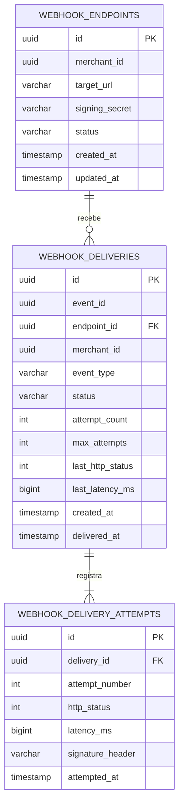

# 🗄️ 02 — Modelagem Conceitual de Dados v1 (`webhooks`)

> **Versão:** `v1.0-frozen` (Semana 4 — `webhook-dispatcher`)  
> **Responsável:** Chat 01 (Arquiteto de Software & Contratos)  
> **Banco Alvo:** PostgreSQL 16 · Database `ledgerpulse` · Schema `webhooks` (conforme decisão fechada em [STATUS.md](file:///C:/Users/aliss/OneDrive/Documentos/AlissonDev/Estudo_Java/ProjetosGitHub/ledgerpulse-platform/docs/STATUS.md) e [01-create-schemas.sql](file:///C:/Users/aliss/OneDrive/Documentos/AlissonDev/Estudo_Java/ProjetosGitHub/ledgerpulse-platform/infra/postgres/init/01-create-schemas.sql))

---

## 1. Visão Geral & Isolamento entre Microsserviços

O schema `webhooks` isola as tabelas operacionais do microsserviço `webhook-dispatcher` (`:8082`).  
Por decisão arquitetural de desacoplamento entre serviços, `merchant_id` é armazenado como `UUID NOT NULL` **sem chave estrangeira cross-schema** para `ledger_core.merchants`, garantindo que o `webhook-dispatcher` opere e execute seus testes Flyway/H2 de forma totalmente independente.

---

## 2. Migration `V1__create_webhooks_tables.sql` (Dia 22)

### 2.1 `webhooks.webhook_endpoints`
Cadastro de URLs de destino e segredos HMAC-SHA256 configurados por merchant.

| Coluna | Tipo SQL | Restrições / Default | Descrição |
| :--- | :--- | :--- | :--- |
| `id` | `UUID` | `PRIMARY KEY` | Identificador único do endpoint. |
| `merchant_id` | `UUID` | `NOT NULL` | Merchant proprietário (sem FK cross-schema). |
| `target_url` | `VARCHAR(500)` | `NOT NULL` | URL HTTP(S) de entrega do webhook. |
| `signing_secret` | `VARCHAR(255)` | `NOT NULL` | Segredo HMAC-SHA256 usado na assinatura (`X-LedgerPulse-Signature`); **nunca** retornado em texto puro nas APIs REST. |
| `description` | `VARCHAR(255)` | `NULL` | Descrição amigável do destino. |
| `status` | `VARCHAR(20)` | `NOT NULL DEFAULT 'ACTIVE' CHECK (status IN ('ACTIVE', 'PAUSED'))` | Estado operacional do endpoint. |
| `created_at` | `TIMESTAMP WITH TIME ZONE` | `NOT NULL DEFAULT CURRENT_TIMESTAMP` | Data/hora UTC de criação. |
| `updated_at` | `TIMESTAMP WITH TIME ZONE` | `NOT NULL DEFAULT CURRENT_TIMESTAMP` | Data/hora UTC da última atualização. |

---

### 2.2 `webhooks.webhook_deliveries`
Estado consolidado e idempotente da entrega de um evento para um endpoint específico.

| Coluna | Tipo SQL | Restrições / Default | Descrição |
| :--- | :--- | :--- | :--- |
| `id` | `UUID` | `PRIMARY KEY` | Identificador único da entrega (`deliveryId`). |
| `event_id` | `UUID` | `NOT NULL` | Identificador único do evento (`eventId` do envelope RabbitMQ). |
| `endpoint_id` | `UUID` | `NOT NULL REFERENCES webhooks.webhook_endpoints(id)` | Endpoint destino vinculado. |
| `merchant_id` | `UUID` | `NOT NULL` | Merchant proprietário do evento. |
| `event_type` | `VARCHAR(80)` | `NOT NULL` | Routing key / tipo do evento (ex.: `payment.settled`). |
| `correlation_id` | `VARCHAR(64)` | `NOT NULL` | `X-Correlation-Id` propagado do evento. |
| `payload_json` | `TEXT` | `NOT NULL` | Corpo JSON bruto assinado e enviado ao endpoint. |
| `status` | `VARCHAR(20)` | `NOT NULL CHECK (status IN ('PENDING', 'RETRYING', 'DELIVERED', 'DLQ'))` | Estado atual do ciclo de entrega. |
| `attempt_count` | `INTEGER` | `NOT NULL DEFAULT 0` | Número total de tentativas já executadas. |
| `max_attempts` | `INTEGER` | `NOT NULL DEFAULT 4` | Máximo de tentativas antes de ir para `DLQ` (`1` inicial + `3` retries `5s`/`30s`/`120s`). |
| `last_http_status` | `INTEGER` | `NULL` | Último código HTTP retornado pelo destino (ou `null` em timeout/erro de rede). |
| `last_latency_ms` | `BIGINT` | `NULL` | Latência da última tentativa em milissegundos. |
| `last_error` | `TEXT` | `NULL` | Última mensagem de erro registrada. |
| `signature_header` | `VARCHAR(255)` | `NULL` | Último header `X-LedgerPulse-Signature` gerado. |
| `created_at` | `TIMESTAMP WITH TIME ZONE` | `NOT NULL DEFAULT CURRENT_TIMESTAMP` | Data/hora UTC de criação. |
| `updated_at` | `TIMESTAMP WITH TIME ZONE` | `NOT NULL DEFAULT CURRENT_TIMESTAMP` | Data/hora UTC da última atualização. |
| `delivered_at` | `TIMESTAMP WITH TIME ZONE` | `NULL` | Data/hora UTC da entrega confirmada (`2xx`). |

**Constraint Única de Idempotência:**
- `CONSTRAINT uq_webhook_deliveries_event_endpoint UNIQUE (event_id, endpoint_id)` — impede entregas duplicadas no consumidor *at-least-once* quando `(eventId, endpointId)` já foi entregue (`DELIVERED`).

---

### 2.3 `webhooks.webhook_delivery_attempts`
Trilha auditável (append-only) de cada tentativa HTTP executada em Virtual Threads.

| Coluna | Tipo SQL | Restrições / Default | Descrição |
| :--- | :--- | :--- | :--- |
| `id` | `UUID` | `PRIMARY KEY` | Identificador único da tentativa. |
| `delivery_id` | `UUID` | `NOT NULL REFERENCES webhooks.webhook_deliveries(id)` | Entrega pai. |
| `attempt_number` | `INTEGER` | `NOT NULL CHECK (attempt_number > 0)` | Ordem sequencial da tentativa (`1, 2, 3, 4...`). |
| `http_status` | `INTEGER` | `NULL` | Status HTTP recebido (ou `null` em timeout/falha de conexão). |
| `latency_ms` | `BIGINT` | `NOT NULL CHECK (latency_ms >= 0)` | Tempo de resposta em milissegundos. |
| `signature_header` | `VARCHAR(255)` | `NOT NULL` | Valor exato do header `X-LedgerPulse-Signature: t=...,v1=...`. |
| `error_message` | `TEXT` | `NULL` | Detalhe do erro quando não `2xx`. |
| `attempted_at` | `TIMESTAMP WITH TIME ZONE` | `NOT NULL DEFAULT CURRENT_TIMESTAMP` | Data/hora UTC da tentativa. |

---

### 2.4 Índices da `V1__create_webhooks_tables.sql`

- `idx_webhook_endpoints_merchant_status` ON `webhooks.webhook_endpoints (merchant_id, status)`
- `idx_webhook_deliveries_status_created` ON `webhooks.webhook_deliveries (status, created_at DESC)`
- `idx_webhook_deliveries_merchant_created` ON `webhooks.webhook_deliveries (merchant_id, created_at DESC)`
- `idx_webhook_delivery_attempts_delivery_num` ON `webhooks.webhook_delivery_attempts (delivery_id, attempt_number ASC)`

---

## 3. Nota de Portabilidade DDL (PostgreSQL 16 ↔ H2 `2.2.224` `MODE=PostgreSQL`)

Para que os testes automatizados (`mvn test` usando H2 em memória e `mvn verify` com Testcontainers) executem **exatamente a mesma migration Flyway `V1__create_webhooks_tables.sql`** sem falhas de sintaxe:

1. **JDBC URL recomendada para `application-test.yml` (H2):**
   `jdbc:h2:mem:ledgerpulse_webhooks_test;MODE=PostgreSQL;DATABASE_TO_LOWER=TRUE;DEFAULT_NULL_ORDERING=HIGH;DB_CLOSE_DELAY=-1;INIT=CREATE SCHEMA IF NOT EXISTS webhooks`
2. **Qualificação explícita de schema:** todas as tabelas e FKs usam o prefixo `webhooks.` (com `spring.flyway.schemas=webhooks` e `spring.jpa.properties.hibernate.default_schema=webhooks`). Não usar `SET search_path` dentro da migration.
3. **Tipos de data e texto portáteis (Regra Obrigatória):**
   - Usar **sempre `TIMESTAMP WITH TIME ZONE`** e **nunca `TIMESTAMPTZ`** no DDL (garante compatibilidade estrita com H2 `2.2.224` `MODE=PostgreSQL` e PostgreSQL 16), com `DEFAULT CURRENT_TIMESTAMP`.
   - Usar `TEXT` para `payload_json` em vez de `JSONB`.
4. **Geração de UUID na aplicação:** não utilizar `CREATE EXTENSION` nem `DEFAULT gen_random_uuid()` no DDL; todos os UUIDs são gerados no Java (`UUID.randomUUID()`).

---

## 4. Semente Dev Local Padrão (`dev` / `test`)

Para viabilizar imediatamente os testes da Semana 4 (Retries, Sink, Console DLQ e E2E), o `webhook-dispatcher` deve provisionar em ambientes não-produtivos (`@Profile({"local", "dev", "test"})` ou equivalente) o endpoint padrão abaixo, de forma idempotente:

| Campo | Valor Padrão (`dev` / `test`) |
| :--- | :--- |
| **`id`** | `33333333-3333-4333-8333-333333333333` |
| **`merchant_id`** | `7b92c3e0-1f42-4876-a1e2-901283471234` (`Acme Fintech Store`) |
| **`target_url`** | `http://localhost:8082/api/v1/sink/test` |
| **`signing_secret`** | `whsec_ledgerpulse_dev_secret_2026` |
| **`description`** | `Merchant Webhook Sink Local (Acme Fintech Store)` |
| **`status`** | `ACTIVE` |

> **Nota sobre o `target_url` no Docker Compose:** como o **Merchant Webhook Sink** (`POST /api/v1/sink/test`) executa dentro do próprio serviço `webhook-dispatcher` na porta `8082`, `http://localhost:8082/api/v1/sink/test` funciona tanto rodando localmente no host quanto dentro do próprio container `webhook-dispatcher`.
