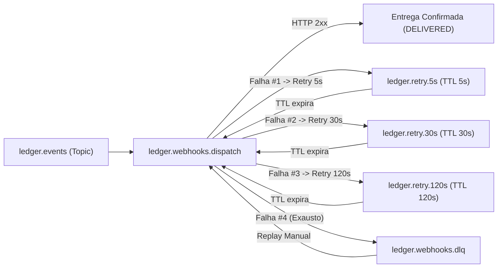

# 🐇 Contrato de Mensageria & Eventos RabbitMQ (`events-rabbitmq.md`)

> **Versão do Contrato:** `v1`  
> **Responsável:** Chat 01 (Arquiteto de Software & Contratos)  
> **Garantia:** Transactional Outbox (*at-least-once* na publicação) + Idempotência por `eventId` no consumidor.

---

## 1. Topologia de Exchanges e Filas

| Componente | Tipo | Nome Oficial | Função |
| :--- | :--- | :--- | :--- |
| **Exchange Principal** | `topic` (durable) | `ledger.events` | Recebe todos os eventos publicados pelo `OutboxRelayWorker` do `ledger-core-api`. |
| **Exchange de Retry** | `direct` (durable) | `ledger.retry` | Roteia mensagens falhas para filas de atraso com TTL exponencial. |
| **Dead-Letter Exchange** | `direct` (durable) | `ledger.dlx` | Encaminha mensagens esgotadas (após 3 retentativas) para a DLQ final. |
| **Fila Principal de Webhooks** | `queue` (durable) | `ledger.webhooks.dispatch` | Consumida pelo `webhook-dispatcher` (`x-dead-letter-exchange: ledger.retry`). |
| **Fila Retry 1 (5s)** | `queue` (durable) | `ledger.retry.5s` | `x-message-ttl: 5000`, devolve para `ledger.events` ao expirar. |
| **Fila Retry 2 (30s)** | `queue` (durable) | `ledger.retry.30s` | `x-message-ttl: 30000`, devolve para `ledger.events` ao expirar. |
| **Fila Retry 3 (2min)** | `queue` (durable) | `ledger.retry.120s` | `x-message-ttl: 120000`, devolve para `ledger.events` ao expirar. |
| **Dead-Letter Queue (DLQ)** | `queue` (durable) | `ledger.webhooks.dlq` | Armazena eventos que falharam em todas as tentativas até replay manual via API/UI. |

---

## 2. Política de Retry Exponencial (5s → 30s → 120s → DLQ)



---

## 3. Routing Keys Oficiais (`eventType`)

| Routing Key / `eventType` | Produtor | Quando é Emitido |
| :--- | :--- | :--- |
| `payment.created` | `ledger-core-api` | Cobrança registrada antes da conclusão ou quando entra em análise. |
| `payment.manual_review_required` | `ledger-core-api` | Motor de risco retornou `REVIEW` ou houve fallback de Circuit Breaker. |
| `payment.settled` | `ledger-core-api` | Pagamento autorizado e partidas dobradas + split gravados no Ledger. |
| `payment.declined` | `ledger-core-api` | Pagamento bloqueado pelo antifraude ou reprovado na revisão manual. |
| `payment.refunded` | `ledger-core-api` | Estorno total ou parcial liquidado com lançamentos compensatórios. |
| `risk.feedback.recorded` | `ledger-core-api` | Analista concluiu revisão manual (útil para retreino futuro de ML). |

---

## 4. Envelope JSON Padrão do Evento

Todo evento gravado em `outbox_events` e enviado para `ledger.events` deve obedecer exatamente a este envelope:

```json
{
  "eventId": "c7a615f1-82b3-4e11-9c2a-5d2d1b63e701",
  "eventType": "payment.settled",
  "schemaVersion": "1.0",
  "occurredAt": "2026-11-20T22:31:05Z",
  "correlationId": "4f3c9f62-8b9a-4f3b-9d1a-0192837465ab",
  "merchantId": "7b92c3e0-1f42-4876-a1e2-901283471234",
  "payload": {
    "paymentId": "e1d2c3b4-5a6b-4c7d-8e9f-001122334455",
    "ledgerTransactionId": "f9e8d7c6-5b4a-4321-8765-112233445566",
    "amountCents": 15000,
    "platformFeeCents": 375,
    "netMerchantCents": 14625,
    "currency": "BRL",
    "status": "SETTLED",
    "riskScore": 14,
    "reasonCodes": []
  }
}
```

### Regras de Consumidor Idempotente (`webhook-dispatcher`)
1. Ao receber mensagem da fila, verificar na tabela `webhook_deliveries` se `(eventId, endpointId)` já possui registro `DELIVERED`.
2. Calcular assinatura HMAC-SHA256 sobre `timestamp + "." + rawJsonBody` usando o `secret` do endpoint cadastrado.
3. Enviar header `X-LedgerPulse-Signature: t=<unix_epoch>,v1=<hex_hmac>`, além de `X-LedgerPulse-Event-Id` e `X-Correlation-Id`.
